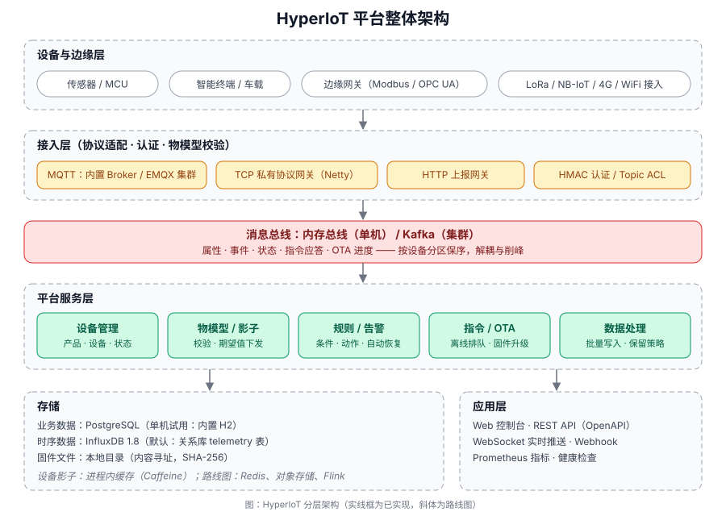

# HyperIoT

通用物联网（IoT）平台：设备接入、产品物模型、设备影子、规则与告警、远程指令、OTA 升级，附带 Web 控制台、REST API 和设备模拟器。
**单个 JAR 开箱即用**（内置 MQTT Broker + H2 数据库），生产栈一个 profile 切换到 **PostgreSQL + Kafka + EMQX + InfluxDB 1.8**。



## 功能

| 模块 | 说明 |
| --- | --- |
| **设备接入** | MQTT 3.1.1（内置 Broker 或外接 EMQX）、HTTP 上报、TCP 私有协议（Netty 示例网关）。设备用 HMAC-SHA256 签名认证，密钥不上网；每个设备只能访问自己的 Topic |
| **产品与物模型** | 属性 / 事件 / 服务，类型、范围、枚举校验；上报数据按物模型过滤，非法数据拒绝并记录 |
| **设备影子** | 保存最后上报值与待下发的期望值；设备离线时设置，上线后自动补发；上报与期望一致后自动清除 |
| **规则与告警** | 多条件（AND / OR）阈值规则，动作支持“下发指令”和 Webhook；同一规则同一设备只保留一条活跃告警，条件消失自动恢复，支持确认 |
| **远程指令** | 服务调用有完整状态机（待发送 / 已发送 / 成功 / 失败 / 超时）；离线指令带 TTL 排队，上线补发；支持同步等待应答 |
| **OTA 升级** | 固件上传（SHA-256 校验）、按产品 / 设备批量升级、带签名的下载地址（支持断点续传）、逐设备进度、卡死检测 |
| **时序数据** | 批量写入（削峰、失败重试）、原始值 / 聚合（avg / max / min / last）查询、保留策略；存储可选关系库表或 **InfluxDB 1.8** |
| **控制台** | 看板（实时消息流）、产品与物模型编辑、设备详情（实时属性 / 曲线 / 事件 / 服务调用 / 日志）、规则、告警、指令、OTA。无前端构建步骤，无外部依赖 |
| **运维** | Prometheus 指标、健康检查、OpenAPI（Swagger UI）、优雅停机、Docker / Compose |

## 5 分钟体验

需要 JDK 17 和 Maven 3.9+。

```bash
# 1. 构建（同时跑完全部测试；加 -DskipTests 可跳过）
mvn -B package

# 2. 启动平台（内置 MQTT :1883，控制台 :8080，数据保存在 ./data）
HYPERIOT_ADMIN_PASSWORD='换成你的密码(至少8位)' java -jar hyperiot-server/target/hyperiot-server-0.1.0-SNAPSHOT.jar
# 不设置密码时，首次启动会生成随机管理员密码并打印在日志里

# 3. 打开 http://localhost:8080，用 admin / 你的密码登录
```

创建演示数据并启动一台模拟设备：

```bash
HYPERIOT_ADMIN_PASSWORD='同上' ./scripts/seed-demo.sh     # 创建产品、设备、规则，并打印模拟器启动命令
HYPERIOT_DEVICE_SECRET='<脚本打印的设备密钥>' \
  java -jar hyperiot-simulator/target/hyperiot-simulator-0.1.0-SNAPSHOT.jar \
  --product-key <productKey> --device-name thermostat-001 --interval 3
```

模拟器会周期上报温湿度、偶尔“发烧”触发告警规则、响应服务调用、应用属性设置、执行 OTA 升级。在控制台里可以看到数据实时滚动。

**一次模拟多台设备**：在控制台设备页点“批量创建”，下载生成的 `devices.csv`（列：`productKey,deviceName,deviceSecret`），然后：

```bash
java -jar hyperiot-simulator/target/hyperiot-simulator-0.1.0-SNAPSHOT.jar   --devices-file devices.csv --host <broker地址> --port 1883 --interval 3
```

一个进程里每台设备各自独立连接、上报、应答指令。可选参数：

| 参数 | 默认 | 说明 |
| --- | --- | --- |
| `--interval` | 5 | 上报间隔（秒，可用小数） |
| `--connect-rate` | 200 | 每秒新建多少个连接（旧参数 `--stagger-ms` 仍可用，换算成 1000/N） |
| `--limit` | 全部 | 只用清单里的前 N 台，方便从 1000 台逐步加到 1 万台 |
| `--qos` | 1 | 上报的 QoS，0 或 1 |
| `--keepalive` | 60 | MQTT 心跳（秒） |
| `--quiet` | 超过 20 台自动开 | 不打印每台设备的日志，只每 5 秒输出一行汇总 |

清单也可以只有两列 `deviceName,deviceSecret`，再配合 `--product-key`。

**模拟 1 万台设备**：批量创建接口每次最多 500 台，用脚本循环生成清单（清单含设备密钥，不要提交到 git）：

```bash
HYPERIOT_URL=http://localhost:8080 HYPERIOT_ADMIN_PASSWORD=... ./scripts/create-devices.sh <productKey> 10000 devices.csv
java -Xmx2g -jar hyperiot-simulator/target/hyperiot-simulator-0.1.0-SNAPSHOT.jar --devices-file devices.csv --host <broker地址> --interval 10 --connect-rate 300
```

所有设备共用一组 Netty 线程和一个调度器（线程数与设备数无关），1 万台约占 0.5 GB 内存；运行时每 5 秒打印一行：在线数、每秒发送/确认条数、失败数、下行条数、被拒绝数、重连次数、堆内存。被 broker 拒绝的设备每 10–30 秒重试一次（密码错了会一直被拒，但 EMQX 在平台认证钩子暂时调不通时也会返回 NOT_AUTHORIZED，所以不能放弃）；断线按指数退避加随机抖动重连，平台重启后不会同时涌回来。
> 机器的限制：Windows 动态端口默认只有约 1.6 万个，单机连同一个 broker 到 1 万台没问题，再多要放宽端口范围或换机器；上报速率 = 设备数 ÷ 间隔，1 万台、间隔 10 秒约 1000 条/秒。

> 默认端口 8080 / 1883 被占用时：`SERVER_PORT=18080 HYPERIOT_MQTT_PORT=11883`（同时把 `HYPERIOT_PUBLIC_BASE_URL` 改成对应地址）。

### 生产栈：PostgreSQL + Kafka + EMQX + InfluxDB 1.8

```bash
java -jar hyperiot-server/target/hyperiot-server-0.1.0-SNAPSHOT.jar --spring.profiles.active=prod
```

`prod` 等价于 `postgres,kafka,emqx,influx`，各组件的地址和账号用环境变量传（`HYPERIOT_DB_*`、`HYPERIOT_KAFKA_SERVERS`、`HYPERIOT_MQTT_*`、`HYPERIOT_INFLUX_*`），每个组件需要你准备什么见 **[docs/deployment.md](docs/deployment.md#生产栈postgresql--kafka--emqx--influxdb-18)**。

### Docker

```bash
cp .env.example .env        # 填好密码类变量
docker compose up -d --build                         # 单机：HyperIoT + PostgreSQL
docker compose -f docker-compose.cluster.yml up -d   # 生产栈：EMQX + Kafka + PostgreSQL + InfluxDB 1.8（实验性，见 docs/deployment.md）
```

## 设备怎么接入

```
clientId = {productKey}.{deviceName}
username = {deviceName}&{productKey}
password = {deviceSecret}      # 设备密钥本身；也可以用它的 HMAC-SHA256 签名（见 docs/protocol.md），公网请走 TLS

上行  hyperiot/{productKey}/{deviceName}/thing/property/post      {"id":"1","params":{"temperature":25.5}}
下行  hyperiot/{productKey}/{deviceName}/thing/service/{名}/invoke {"id":"<requestId>","params":{...}}
```

完整的主题、载荷、HTTP / TCP 协议、OTA 流程见 **[docs/protocol.md](docs/protocol.md)**；REST 与 WebSocket 接口见 **[docs/api.md](docs/api.md)**（运行后也可访问 `/swagger-ui.html`）。

## 文档

- [docs/protocol.md](docs/protocol.md)：设备接入协议
- [docs/api.md](docs/api.md)：REST / WebSocket API
- [docs/message-lifecycle.md](docs/message-lifecycle.md)：消息上行与下行的完整生命周期（Kafka、EMQX、数据库各管什么）
- [docs/telemetry-pipeline.md](docs/telemetry-pipeline.md)：遥测数据从 Kafka 到时序库的处理过程（结合代码）
- [docs/device-lifecycle.md](docs/device-lifecycle.md)：设备认证、上线下线流程、队列设计
- [docs/architecture.md](docs/architecture.md)：设计说明（消息流、状态机、一致性取舍、已知限制）
- [docs/deployment.md](docs/deployment.md)：配置项、PostgreSQL / EMQX / Kafka 部署、TLS、监控、安全清单

## 项目结构

```
hyperiot-server/        平台服务（Spring Boot 3 / Java 17）
  access/               接入层：MQTT（内置 / EMQX）、HTTP、TCP 网关，Topic 与 ACL
  bus/                  消息总线：内存实现 / Kafka 实现
  model/                物模型定义与校验
  device/ product/      设备与产品管理、在线状态
  shadow/ rule/ alarm/  影子、规则引擎、告警
  command/ ota/         指令状态机、固件与升级任务
  data/ dashboard/      时序写入与查询、事件、设备日志、看板
  auth/ config/ realtime/  JWT 登录、安全配置、WebSocket 推送
  resources/static/     Web 控制台（原生 ES modules，无构建）
hyperiot-simulator/     设备模拟器（可执行 JAR）
docs/ scripts/          文档、演示数据脚本
```

## 测试

`mvn verify` 会跑单元测试和集成测试。集成测试启动完整的平台（内置 Broker + H2），用真实的 MQTT / HTTP / TCP / WebSocket 客户端走完：设备认证与越权拒绝、属性上报到影子与时序库、物模型校验、规则告警与恢复、指令（含离线排队、超时、失败）、影子期望值、HTTP 与 TCP 网关、OTA 全流程、外接 Broker 模式；另有基于内嵌 Kafka 的总线测试。

## 当前状态与已知限制

诚实地列出来，方便你判断能否用于你的场景：

- **版本 0.1**：功能完整可运行，但没有经过生产流量验证。
- **PostgreSQL、真实 EMQX 没有实测**：开发环境没有 Docker，PostgreSQL 配置、`docker-compose*.yml`、EMQX 的认证 / 授权 / `$SYS` 事件配置是按文档编写的。自动化测试覆盖的是 H2 和“用内置 Broker 模拟外接 Broker”。首次接这两个组件请先在测试环境冒烟。
- **InfluxDB 1.8.10 已对真实服务器验证**：`InfluxRealServerIT` 在真实实例上建一个临时库，验证建库与保留策略、写入（含整数 / 小数混写）、原始值与 avg / max / min / last 聚合、特殊字符、按设备删除，然后只删除自己建的临时库。默认跳过，运行方式：`HYPERIOT_TEST_INFLUX_URL=http://<influx>:8086 mvn -pl hyperiot-server test -Dtest=InfluxRealServerIT`（有认证时再设 `HYPERIOT_TEST_INFLUX_USER` / `_PASSWORD`）。
- **内置 Broker 适合开发和中小规模**（Moquette，单节点）。大规模接入请用 EMQX 集群（`HYPERIOT_MQTT_MODE=external`）。
- **影子缓存是进程内的**：多节点部署时期望值写入走数据库，但各节点缓存不同步（Redis 共享缓存在路线图里）。
- **单一管理员账号**，没有多租户与细粒度权限；设备密钥以明文存库（HMAC 校验需要原始密钥），请保护好数据库。
- **没有内置 TLS**：生产环境在前面放反向代理（控制台 / HTTP）、EMQX 或 stunnel（MQTT / TCP）。签名密码是静态的，公网务必走 TLS。
- 默认时序存储是普通关系表（H2 / PostgreSQL），适合百万级以内的点位；数据量大时用 InfluxDB（`influx` profile）。

## 路线图

InfluxDB 降采样 / 连续查询 · Redis 共享影子与在线状态 · 多租户与角色权限 · 规则持续时间 / 去抖 / 设备离线告警 · 数据转发（Kafka / HTTP）· CoAP / LwM2M 网关 · 设备分组与批量指令 · Flink 流计算对接

## 许可证

[MIT](LICENSE)
