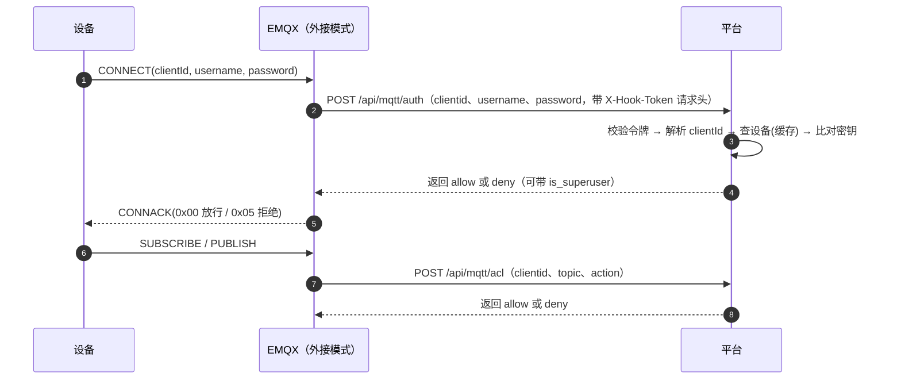
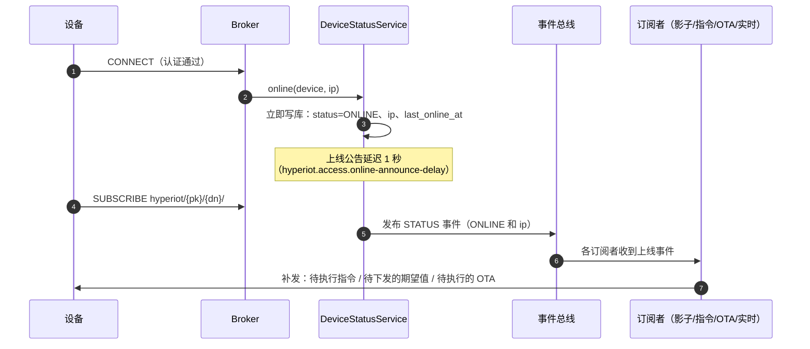
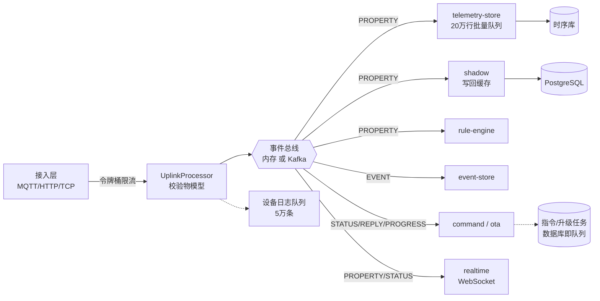
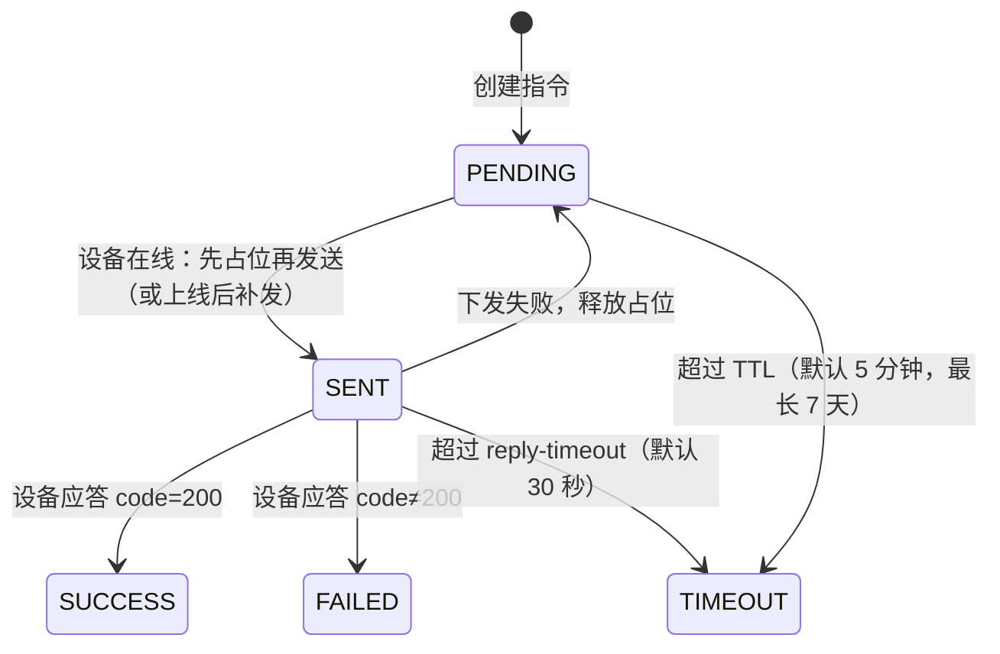

# 设备认证、上线下线与队列设计

> 消息从设备到平台（上行）、从平台到设备（下行）的完整路径见 [message-lifecycle.md](message-lifecycle.md)。

本文描述一个设备从“连接认证”到“上线、通信、下线”的完整流程，以及平台内各处队列的设计与取舍。内容与代码一一对应，括号里给出对应的类，方便对照。

## 1. 设备认证

### 1.1 三元组与凭证

设备在平台里的身份是三元组：`productKey`（产品标识）、`deviceName`（设备名）、`deviceSecret`（设备密钥）。MQTT 连接时它们映射为：

| MQTT 字段 | 值 |
| --- | --- |
| `clientId` | `{productKey}.{deviceName}` |
| `username` | `{deviceName}&{productKey}` |
| `password` | `{deviceSecret}`（明文），或 `hex(HMAC-SHA256(deviceSecret, "clientId"+clientId+"deviceName"+deviceName+"productKey"+productKey))` |

两种密码都被接受（`DeviceCredentials.verifyPassword`）。明文密码由 `hyperiot.security.allow-plain-device-password` 控制，默认开启；公网环境必须走 TLS（EMQX 的 8883）。比较一律用常量时间（`Hmac.safeEquals`）。

### 1.2 谁来验证

**验证发生在 Broker 收到 CONNECT 的那一刻**，由 Broker 决定回 CONNACK 放行还是拒绝；但“三元组对不对”的判断依据在平台里。两种部署方式：

| 模式 | 认证实现 | 授权实现 |
| --- | --- | --- |
| **内置 Broker**（`mqtt.mode=embedded`，默认） | Moquette 的 `IAuthenticator`，进程内直接调用（`EmbeddedMqttBroker.Authenticator`） | `IAuthorizatorPolicy`（`Topics.canPublish / canSubscribe`） |
| **外接 EMQX**（`mqtt.mode=external`） | EMQX 的 HTTP 认证 → `POST /api/mqtt/auth`（`EmqxHookController`） | EMQX 的 HTTP 授权 → `POST /api/mqtt/acl` |

认证的判定顺序（外接模式的钩子与内置 Broker 逻辑一致）：

1. （仅钩子）校验 `X-Hook-Token`；**令牌未配置时一律拒绝**（fail closed）。
2. 平台自己的连接账号（`hyperiot.mqtt.username` / `password`）→ 返回 `allow` 且 `is_superuser=true`。平台以此账号连 EMQX 做共享订阅和下行发布，超级用户不受授权限制。
3. `clientId` 必须能解析成 `{productKey}.{deviceName}`，且 `username` 必须等于 `{deviceName}&{productKey}`。
4. 设备必须存在且 `enabled`（`DeviceService.resolve`，见 1.4）。
5. 密码校验通过。

任何一步不满足都是 `deny`，且**不区分原因**（不泄露设备是否存在）。

### 1.3 授权（ACL）

设备只能访问自己的命名空间 `hyperiot/{productKey}/{deviceName}/…`（`Topics`）：

- **发布**：只允许“上行主题”（属性、事件、服务应答、`shadow/get`、`ota/inform`、`ota/progress`），且命名空间必须是自己的。设备不能发布 `…/thing/property/set`、`…/invoke` 这类下行主题，因此无法伪造平台指令。
- **订阅**：订阅过滤器必须以自己的基础路径开头。产品标识和设备名不含 MQTT 通配符，所以这样的过滤器不可能匹配到别人的主题；`dev1` 与 `dev10` 这类前缀相同的设备也不会互相泄露（基础路径以 `/` 结尾）。

### 1.4 设备缓存与失效

认证发生在每次连接，不能每次都查库。`DeviceService.resolve(productKey, deviceName)` 用 Caffeine 缓存设备（含密钥），TTL 30 秒，上限 10 万条，**未知设备也会缓存（负缓存）**，防止随机 clientId 的探测打到数据库。

缓存在这些时刻失效：创建、更新（禁用）、重置密钥、删除。其中禁用、重置密钥、删除还会发布 `DeviceChangedEvent`，由 `DownlinkService` 通知各接入通道**立即踢掉该设备的现有连接**（内置 Broker：`disconnectClient`；TCP：关闭连接）。

> 外接 EMQX 时，被禁用设备的**已建立连接**不会被平台直接踢掉（平台不控制 EMQX 的连接），要靠设备下次重连时认证失败，或在 EMQX 里手动踢。

### 1.5 其他接入方式的认证

| 方式 | 认证 | 说明 |
| --- | --- | --- |
| HTTP 上报 | 请求头 `X-Signature = hex(HMAC-SHA256(deviceSecret, 请求体原文))` | 设备不存在与签名错误统一返回 `401`；请求体上限 64 KB（`HttpGatewayController`） |
| TCP 私有协议 | 首帧 `auth`：`sign = hex(HMAC-SHA256(secret, "productKey"+pk+"deviceName"+dn))`，10 秒内必须完成 | 失败返回 `{"type":"auth_reply","code":401}` 并断开；同一设备重复登录踢掉旧连接（`TcpGateway`） |
| OTA 下载 | 下载地址带 `sig = HMAC(secret, "ota"+firmwareId+deviceName)` | 无需登录态 |

## 2. 上线与下线

### 2.1 状态是怎么判定的

| 接入方式 | 上线 | 下线 |
| --- | --- | --- |
| MQTT 内置 Broker | Moquette 连接拦截器 `onConnect` | `onDisconnect` / `onConnectionLost` |
| MQTT 外接 EMQX | 订阅 `$SYS/brokers/+/clients/+/connected`；或 EMQX 调 `POST /api/mqtt/event`（`client.connected`） | `$SYS/…/disconnected`；或 `POST /api/mqtt/event`（`client.disconnected`） |
| HTTP | 该设备**首次**上报（`HttpPresence`） | 5 分钟无上报，每 30 秒扫描一次 |
| TCP | 认证成功 | 连接断开（`channelInactive`）；空闲超过 `hyperiot.tcp.idle-timeout`（默认 3 分钟）被关闭 |

平台**重启时**先把所有 `ONLINE` 设备重置为 `OFFLINE`（`DeviceStatusService.resetStaleOnlineState`），因为重启后没有任何连接；设备重连后恢复。

### 2.2 上线流程（MQTT）

**为什么上线公告要延迟约 1 秒？** 设备通常在 CONNACK 之后才订阅自己的下行主题。如果上线时立即下发排队的指令，此时订阅还不存在，Broker 会**静默丢弃**消息，而指令已被标记为“已发送”，最终只能等超时。延迟给设备留出订阅时间。`status` 字段（库里的在线状态）不延迟，立即变成 `ONLINE`。

- 延迟期内设备又断开：公告被取消（`pendingAnnouncements`），不会向已离线的设备下发。
- 同一设备重复上线：旧的待发公告被新的取代。
- TCP / HTTP 设备没有“订阅”这一步，用 `onlineNow` 立即公告。
- 如果订阅得比 1 秒还晚，设备可在订阅后发 `shadow/get` 主动拉取最新状态。

上线事件的消费者（均为总线订阅者，见 §3）：

| 订阅者 | 收到 `ONLINE` 后做什么 |
| --- | --- |
| `shadow` | 有未生效的期望值 → 下发 `thing/property/set` |
| `command` | 取该设备所有 `PENDING` 且未过期的指令，按创建顺序补发 |
| `ota` | 该设备有 `PENDING` 的升级任务 → 下发 `ota/upgrade`，状态转为 `NOTIFIED` |
| `realtime` | 推送 `status` 事件给控制台 WebSocket |

### 2.3 下线流程（MQTT）

1. Broker 通知断开（正常 `DISCONNECT`、网络断开、被踢都会触发）。
2. **重连竞态处理**（内置 Broker）：设备快速重连时，新连接可能先于旧连接的断开事件到达。处理断开前会检查该 `clientId` 是否仍在 Broker 的连接列表里，仍在则忽略这次断开，避免把刚上线的设备误标为离线（`EmbeddedMqttBroker.offline`）。
3. `DeviceStatusService.offline`：取消尚未发出的上线公告 → 写库 `status=OFFLINE`、`last_offline_at` → 清掉内存里的 `lastSeen` → 发布 `STATUS {OFFLINE}`。
4. 下线事件目前只有 `realtime` 订阅（推送给控制台）；指令、影子、OTA 不需要处理下线——它们的状态都在库里，设备下次上线时补发。

### 2.4 最近活跃时间（`last_seen_at`）

每条上行消息都会调用 `touch(deviceId, ts)`，只更新内存里的 `lastSeen` 映射；`DeviceStatusService.flushLastSeen` **每 5 秒**批量回写数据库（条件更新，只写更大的时间戳）。这样高频上报不会变成高频写库。

## 3. 队列设计

平台里有多处队列，目的不同、丢失语义不同。先看全景：

### 3.1 入口限流（令牌桶）

每个设备一个令牌桶（`UplinkProcessor.RateBucket`）：每秒 `rate-limit-per-second`（默认 50）个令牌，容量为 2 倍（突发 100）。超限的消息**直接丢弃**并写一条设备日志，不进入总线。桶按设备缓存，5 分钟无访问淘汰。目的：一个异常设备（死循环上报）不能拖垮整个平台。设为 `0` 关闭。

### 3.2 事件总线

总线是接入层和各处理服务之间的唯一解耦点（`EventBus`）。消息种类（`MessageKind`）：`PROPERTY`、`EVENT`、`STATUS`、`COMMAND_REPLY`、`OTA_PROGRESS`、`SHADOW_GET`。订阅者以“组名”订阅，不同组各收到全部消息，同组多个节点分摊。

订阅者一览：`telemetry-store`、`event-store`、`shadow`、`rule-engine`、`command`、`ota`、`realtime-{随机ID}`（每个节点独立一组，因为每个节点都要把消息推给自己的 WebSocket 连接）。

**内存实现**（`InMemoryEventBus`，单机默认）

| 设计点 | 做法 |
| --- | --- |
| 隔离 | **每个订阅者**拥有自己的 N 个单线程执行器（分区，默认 `bus.partitions=4`），一个慢订阅者不会拖慢别人 |
| 保序 | `分区 = deviceId % N`，同一设备的消息进同一个分区线程，**单设备有序** |
| 有界 | 每个分区一个容量 `bus.queue-size`（默认 20000）的队列 |
| 满了怎么办 | **丢弃**并计数（指标 `hyperiot_bus_dropped_total`），日志告警（10 秒限频）。宁可丢数据，也不让接入层内存溢出 |
| 异常 | 订阅者处理抛异常只记日志，不影响后续消息 |
| 关闭 | 停止接收，最多等待每个执行器 2 秒 |

**Kafka 实现**（`KafkaEventBus`，`hyperiot.bus.type=kafka`）

| 设计点 | 做法 |
| --- | --- |
| Topic | 每种消息一个 topic：`hyperiot.property`、`hyperiot.event`、`hyperiot.status`、`hyperiot.command-reply`、`hyperiot.ota-progress`、`hyperiot.shadow-get`；启动时自动创建（6 分区、1 副本，生产请预建） |
| 保序 | 消息 key = `deviceId`，同一设备落同一分区 |
| 订阅者 | 每个订阅者一个消费者组 `hyperiot-{组名}`，一个轮询线程；多个平台节点自动分摊分区 |
| 可靠性 | 生产者 `acks=1`；消费者 `auto.offset.reset=latest`（新组不回放历史）、自动提交位移。属于“至多一次到至少一次之间”的尽力而为，不是严格的恰好一次；处理失败只记日志 |
| 满了怎么办 | 由 Kafka 承担积压；生产失败只记日志 |

两种实现的语义对比：内存总线重启即丢失在途消息、队列满丢弃；Kafka 总线在平台重启期间消息仍留在 Kafka 中（但 `latest` 的新消费者组不回放历史）。

### 3.3 时序写入队列（削峰）

`TelemetryWriter` 订阅 `PROPERTY`，把每个属性拆成一条样本放进容量 **20 万**的阻塞队列；独立线程每 **500 ms** 或攒满 **500 行**批量写时序库（JDBC 批量插入，或 InfluxDB 行协议批量写入）。

- 失败重试：最多 4 次尝试，退避 500 ms → 1 s → 2 s；仍失败则丢弃该批并记 error 日志。
- 队列满：丢弃新样本，日志告警（每 1000 条提示一次），**不阻塞总线**。
- 停机：先停止接收，再把队列里剩余的样本写完（`@PreDestroy` 等待最多 5 秒）。
- 目的：设备流量尖峰变成少量大批次写入，保护数据库。

### 3.4 设备日志队列

`DeviceLogService`：容量 **5 万**条的队列，每 **1 秒**批量写入（每次最多取 2000 条，按 500 条一批）。队列满直接丢弃日志，**日志绝不拖慢消息处理**。保留 3 天（每小时清理）。写入失败只告警。

### 3.5 影子写回缓存

`ShadowService` 把设备上报（`reported`）合并在内存里，放入“脏集合”，每 **1 秒**批量写库；期望值（`desired`）是低频高价值操作，**写透**，立即落库。脏数据持有强引用，不会被缓存淘汰丢掉；停机时全部刷新。上报乱序时，旧时间戳不会覆盖新值。

### 3.6 指令队列（数据库即队列）

指令不用内存队列，而是**数据库里的状态机**，天然持久、可重启恢复：

- **离线排队**：设备离线时指令停在 `PENDING`，带 `expire_at`（TTL）。设备上线公告到达后，按创建顺序补发所有未过期的指令。
- **先占位再发送**：`PENDING → SENT` 是带条件的 `UPDATE`（只有 `status='PENDING'` 才成功），成功的一方才真正发送。多个节点同时响应同一个“上线”事件也不会把一条指令发两遍；发送失败则回退到 `PENDING`。
- **应答匹配**：按 `requestId`，并校验应答的设备就是被下发的设备。
- **超时扫描**：每 5 秒一次，`SENT` 超过应答超时、或 `PENDING` 超过 TTL，转 `TIMEOUT`。
- **同步等待**：`wait=true` 时 API 在内存里挂一个 `CompletableFuture`，应答到达时完成；先注册再查一次库，避免“应答比注册还早”的竞态。

### 3.7 OTA 待升级队列

同样是数据库状态：`ota_task_device` 里 `PENDING`（离线，等上线）→ `NOTIFIED`（已下发）→ `DOWNLOADING` → `SUCCESS` / `FAILED` / `CANCELED`。设备上线公告到达时，取该设备最新的 `PENDING` 条目下发。每分钟扫描一次，`NOTIFIED` / `DOWNLOADING` 超过 30 分钟无进展的置为 `FAILED`。一个设备同一时间只跟随一个任务，新任务取代旧任务。

### 3.8 WebSocket 推送缓冲

每个控制台连接包装成 `ConcurrentWebSocketSessionDecorator`（发送超时 5 秒、缓冲 256 KB）。客户端太慢导致缓冲溢出时，**直接断开该客户端**，不让慢客户端占用内存。未认证的连接 10 秒后关闭。

## 4. 哪里会丢数据（汇总）

| 位置 | 触发条件 | 丢什么 | 可观测 |
| --- | --- | --- | --- |
| 入口限流 | 单设备超过 50 条/秒 | 超限的上行消息 | 设备日志 |
| 内存总线分区队列 | 某个订阅者处理太慢，队列满 | 该订阅者的消息 | `hyperiot_bus_dropped_total`、日志 |
| 内存总线，平台重启 | 在途消息 | 队列里的消息 | — |
| 时序写入队列 | 库不可用超过重试，或队列满 | 该批 / 新样本 | error 日志 |
| 设备日志队列 | 队列满 | 日志条目 | — |
| 影子 | 进程崩溃（非正常退出） | 最近 1 秒内的上报合并 | — |
| Kafka | 平台宕机期间 `latest` 新组 | 不回放历史 | — |
| **不会丢** | 指令、OTA 任务、告警、设备状态 | 都在数据库里，重启可恢复 | — |

设计原则：**接入层永远不被慢的下游拖住**（队列有界、满了丢弃），**重要的控制类数据（指令、OTA、告警）走数据库状态机**，保证可恢复和幂等。

## 5. 相关配置

| 配置项 | 默认 | 作用 |
| --- | --- | --- |
| `hyperiot.security.allow-plain-device-password` | `true` | 是否接受设备密钥本身作为 MQTT 密码 |
| `hyperiot.access.online-announce-delay` | `1s` | MQTT 设备上线公告的延迟 |
| `hyperiot.access.rate-limit-per-second` | `50` | 单设备上行限流（`0` 关闭） |
| `hyperiot.bus.type` | `memory` | `memory` 或 `kafka` |
| `hyperiot.bus.partitions` / `queue-size` | `4` / `20000` | 内存总线每订阅者的分区数、每分区队列容量 |
| `hyperiot.telemetry.batch-size` / `flush-interval` | `500` / `500ms` | 时序批量写入 |
| `hyperiot.command.reply-timeout` / `default-ttl` / `max-ttl` | `30s` / `5m` / `7d` | 指令超时与排队有效期 |
| `hyperiot.tcp.idle-timeout` | `3m` | TCP 设备空闲断开 |
| `hyperiot.security.hook-token` | 空 | EMQX 钩子令牌，空则钩子一律拒绝 |

## 6. 已知限制

- 内置 Broker 的断开处理要遍历连接列表判断重连竞态，连接数到十万级时不合适，请改用外接 EMQX。
- 外接 EMQX 模式下，设备被禁用后已建立的连接不会被平台踢掉，需等其重连或在 EMQX 里处理。
- 影子缓存是进程内的，多节点时各节点缓存不同步；告警、指令的实时推送只到产生它的节点。
- 内存总线不持久；需要在重启期间不丢消息，请使用 Kafka。
- 平台不保证消息“恰好一次”：上行消息可能因重试重复，下游处理需幂等（指令用 `requestId` 去重）。
