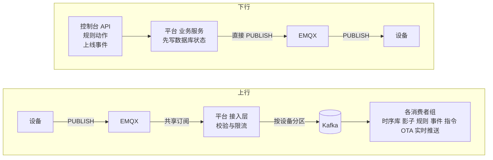
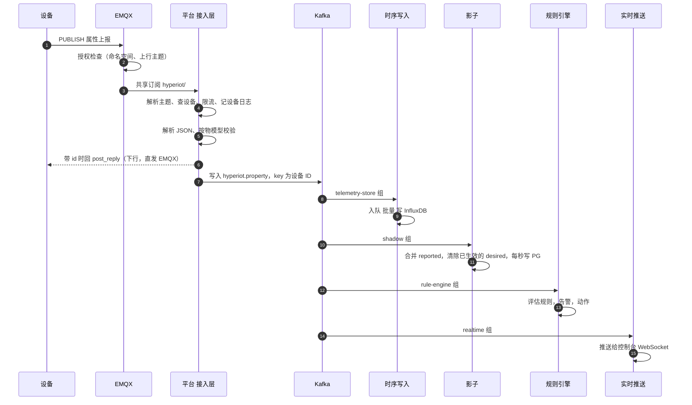
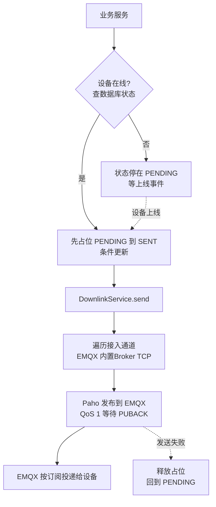
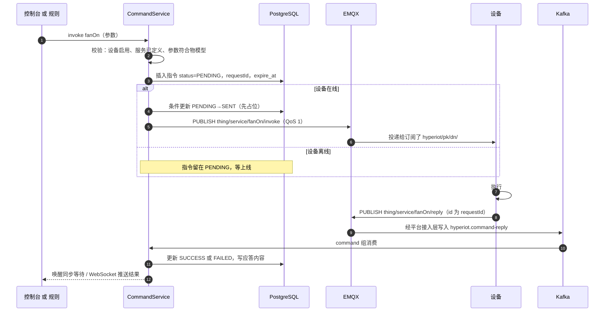

# 消息的上行与下行生命周期

本文以生产栈（EMQX + Kafka + PostgreSQL + InfluxDB）为例，完整说明一条消息从产生到落地的每一步：经过哪些组件、在哪里被校验、存到哪里、出错时会怎样。内容与代码对应，括号里是类名。

> 设备认证、上线下线、各队列的细节见 [device-lifecycle.md](device-lifecycle.md)；主题与载荷格式见 [protocol.md](protocol.md)。

## 1. 先看结论

**Kafka 只出现在上行链路上；下行消息不经过 Kafka，由平台直接发布到 EMQX。**

| | 上行（设备 → 平台） | 下行（平台 → 设备） |
| --- | --- | --- |
| 是否经过 Kafka | **是**，校验后写入，由多个消费者组并行处理 | **否**，业务服务直接调 `DownlinkService` 发布到 EMQX |
| 状态存在哪里 | Kafka 暂存，最终落 InfluxDB / PostgreSQL | **PostgreSQL**（指令、期望值、升级任务的状态机） |
| 设备离线时 | 不适用 | 不发，状态停在 `PENDING`，设备上线后补发 |
| 可靠性手段 | 消息队列 + 分区保序 | 数据库状态机 + 超时扫描 + 应答匹配 |

**为什么下行不走 Kafka？** 下行是“一对一、带状态、需要等应答”的操作：先要在数据库里记下“这条指令发给谁、是否过期”，设备离线要排队，设备应答要对得上。这些状态本来就在数据库里，再经过一次 Kafka 只会多一跳延迟，而且 Kafka 里的消息没法表达“设备在线了才发”。上行则是“多对多、无状态、量大”的数据流，正适合 Kafka 做削峰和扇出。

## 2. 主题回顾

所有主题都在 `hyperiot/{productKey}/{deviceName}/` 之下：

| 方向 | 主题后缀 | 用途 |
| --- | --- | --- |
| 上行 | `thing/property/post` | 属性上报 |
| 上行 | `thing/event/{identifier}/post` | 事件上报 |
| 上行 | `thing/service/{identifier}/reply` | 服务调用应答 |
| 上行 | `shadow/get` | 请求影子 |
| 上行 | `ota/inform`、`ota/progress` | 版本、升级进度 |
| 下行 | `thing/service/{identifier}/invoke` | 调用服务（指令） |
| 下行 | `thing/property/set` | 设置属性（期望值） |
| 下行 | `thing/property/post_reply`、`thing/event/{identifier}/post_reply` | 对设备上报的应答（设备带了 `id` 才回） |
| 下行 | `shadow/get_reply` | 影子内容 |
| 下行 | `ota/upgrade` | 固件升级指令 |

## 3. 上行生命周期

以最常见的“属性上报”为例（`thing/property/post`）。

### 3.1 逐步说明

| 步骤 | 发生什么 | 代码 |
| --- | --- | --- |
| ① 设备发布 | 设备向自己命名空间下的上行主题发布，建议 QoS 1 | — |
| ② EMQX 授权 | EMQX 通过 `/api/mqtt/acl` 询问平台“该设备能否发布这个主题”（EMQX 默认会缓存授权结果，以你的 EMQX 配置为准）；越权的发布被丢弃 | `EmqxHookController`、`Topics.canPublish` |
| ③ 投递给平台 | 平台以共享订阅 `$share/hyperiot/hyperiot/#`（QoS 1）订阅，多个平台节点时每条消息只投给其中一个 | `ExternalMqttGateway` |
| ④ 解析与查设备 | `Topics.parseUplink` 解析主题得到类型；`DeviceService.resolve` 查设备（缓存）；设备不存在或被禁用则直接丢弃 | `UplinkProcessor.onMqtt` |
| ⑤ 限流与记录 | 单设备令牌桶限流（默认 50 条/秒）；计入看板统计；更新“最近活跃时间”（内存，5 秒回写）；原始消息写入设备日志队列 | `UplinkProcessor.process` |
| ⑥ 解析与校验 | 载荷必须是 JSON 对象；`ts` 在“过去 7 天到未来 5 分钟”内才采用，否则用接收时间；属性按物模型逐个校验（类型、范围、枚举、是否声明），非法的被拒绝并记入设备日志，合法的继续 | `ThingModelValidator` |
| ⑦ 应答设备 | 设备带了 `id` 则立即回 `thing/property/post_reply`（`code` 200 或 400）。这是**下行**，直接发 EMQX，见 §4 | `UplinkProcessor.reply` |
| ⑧ 写入 Kafka | 校验通过的数据封装成 `DeviceMessage` 发到 `hyperiot.property`，key 为设备 ID，同一设备落同一分区 | `KafkaEventBus.publish` |
| ⑨ 并行消费 | 4 个消费者组各自独立消费，见下表 | — |

### 3.2 各类消息的消费者与落地

| 上行消息 | Kafka topic | 谁消费 | 落地位置 |
| --- | --- | --- | --- |
| 属性上报 | `hyperiot.property` | `telemetry-store` | 20 万行队列，每 500ms 或 500 行批量写 **InfluxDB**（失败重试 3 次）。详见 [telemetry-pipeline.md](telemetry-pipeline.md) |
| | | `shadow` | 内存合并 `reported`，每秒写 **PostgreSQL**；上报值等于期望值则清除该项期望值 |
| | | `rule-engine` | 评估规则；条件满足则在 PostgreSQL 写告警、执行动作；不再满足则恢复告警 |
| | | `realtime` | 经 WebSocket 推给控制台，不落库 |
| 事件上报 | `hyperiot.event` | `event-store` | **PostgreSQL** `device_event` |
| 服务应答 | `hyperiot.command-reply` | `command` | 按 `requestId` 匹配指令，更新 **PostgreSQL** 状态为 `SUCCESS` / `FAILED`，唤醒同步等待的 API |
| 影子请求 | `hyperiot.shadow-get` | `shadow` | 读影子，**直发** `shadow/get_reply`（下行） |
| 版本 / 升级进度 | `hyperiot.ota-progress` | `ota` | 更新 **PostgreSQL** 升级任务与设备固件版本 |
| 上线 / 下线（平台自己产生） | `hyperiot.status` | `shadow`、`command`、`ota`、`realtime` | 上线时补发期望值、排队指令、待升级任务，见 [device-lifecycle.md](device-lifecycle.md) |

> 内置 Broker 模式下，第 ③ 步不是 EMQX 共享订阅，而是 Moquette 的拦截器 `onPublish` 在进程内回调；HTTP、TCP 网关则在收到请求后直接调用同一个 `UplinkProcessor`。第 ④ 步起完全一致。

### 3.3 上行链路的可靠性

| 环节 | 保证 | 出错时 |
| --- | --- | --- |
| 设备 → EMQX | 取决于设备的 QoS（建议 1） | 设备自己重发 |
| EMQX → 平台 | 共享订阅 QoS 1（至少一次） | 重复投递时同一条消息可能处理两次 |
| 平台校验 | 同步 | 非法数据被拒绝并记日志，不会入队 |
| 平台 → Kafka | `acks=1`，异步发送；Kafka 不可达时最多阻塞 5 秒 | 失败只记日志（尽力而为） |
| Kafka → 消费者 | 自动提交位移；处理异常只记日志，不重试 | 某个订阅者处理失败，不影响其他订阅者 |
| 单设备顺序 | 同一设备同一分区，**有序** | — |
| 重复数据 | 可能重复 | InfluxDB 同一时间戳同一序列的点会覆盖，天然去重；关系库存储则会有重复行 |

## 4. 下行生命周期

下行有四类来源，最终都汇到同一个出口 `DownlinkService.send`：

| 来源 | 触发 | 调用链 |
| --- | --- | --- |
| **服务调用（指令）** | 控制台 / API；或规则动作 `COMMAND` | `CommandService.invoke` |
| **设置属性（期望值）** | 控制台 / API `PUT /desired`；设备上线事件 | `ShadowService.setDesired` / `onOnline` |
| **OTA 升级** | 创建升级任务；设备上线事件 | `OtaService.create` / `pushPending` |
| **即时应答** | 设备上报带 `id`；设备请求影子 | `UplinkProcessor.reply`、`ShadowService.onShadowGet` |

### 4.1 指令（服务调用）的完整往返

指令是下行和上行的一次完整配合，是最能说明两个方向如何衔接的例子：

状态机：

| 状态 | 含义 | 离开条件 |
| --- | --- | --- |
| `PENDING` | 已创建，未发出（设备离线或下发失败回退） | 设备上线后补发 → `SENT`；超过 TTL（默认 5 分钟，最长 7 天）→ `TIMEOUT` |
| `SENT` | 已发布到 EMQX，等设备应答 | 设备应答 `code=200` → `SUCCESS`；其他 → `FAILED`；超过应答超时（默认 30 秒）→ `TIMEOUT` |
| `SUCCESS` / `FAILED` / `TIMEOUT` | 终态 | — |

要点：

- **先占位再发送**：`PENDING → SENT` 是带条件的 `UPDATE`，成功的一方才真正发布。多个节点同时响应“设备上线”也不会把同一条指令发两遍；发布失败则回退到 `PENDING`。
- **发布是同步的**：Paho 的 QoS 1 发布会等 EMQX 的 PUBACK 才返回，所以 API 调用的耗时里包含了这一跳。
- **应答匹配**：按 `requestId` 匹配，并校验应答来自被下发的设备，防止设备 A 应答设备 B 的指令。
- **超时扫描**：每 5 秒一次。

### 4.2 设置属性（期望值）

1. `PUT /api/devices/{id}/desired`：按物模型校验，**只允许 `access=rw` 的属性**，立即写入 PostgreSQL（写透），版本号加 1。
2. 设备在线 → 直接向 `thing/property/set` 发布 `{id, version, params}`；离线 → 不发，等上线。
3. 设备上线（`hyperiot.status` 的 `ONLINE` 事件，延迟约 1 秒）→ `shadow` 组把尚未生效的期望值下发。
4. 设备应用后**通过属性上报回报新值**，上行链路里 `shadow` 组发现“上报值 = 期望值”，清除该项。整个过程不需要设备专门“确认”。

### 4.3 OTA 升级

1. 创建任务：为目标设备在 PostgreSQL 写 `PENDING` 条目；在线设备立即下发 `ota/upgrade`（含带签名的下载地址、大小、SHA-256），条目转 `NOTIFIED`。
2. 离线设备：条目保持 `PENDING`，上线事件到达时下发。
3. 设备通过 **HTTP** 下载固件（不经过 MQTT 和 Kafka），校验 SHA-256。
4. 设备通过 `ota/progress` 上报进度（上行，经 Kafka → `ota` 组），平台更新条目状态；`step=100` 成功，`-1` 失败；也可重启后用 `ota/inform` 上报新版本确认。
5. 超过 30 分钟无进展的条目置为 `FAILED`。

### 4.4 即时应答

设备上报带 `id` 时，平台在校验后**立即同步**回复 `post_reply`；设备请求 `shadow/get` 时，由 `shadow` 组读取后回复 `shadow/get_reply`。两者都是直发 EMQX，没有排队，也不落库（只记设备日志）。

### 4.5 出口：`DownlinkService`

所有下行都调用 `DownlinkService.send(设备, 主题, 载荷)`：

1. 依次询问各个接入通道（外接 EMQX / 内置 Broker / TCP 网关），第一个接受的通道发送；
2. 发送成功后写一条 `DOWN` 方向的设备日志（异步队列）；
3. 如果**没有任何通道接受**，返回 `false`，调用方据此回退状态（例如把指令放回 `PENDING`）。

外接 EMQX 通道只要平台自己的 MQTT 连接正常就会发布，它**不知道设备此刻是否真的在线**——所以调用方先查数据库里的在线状态再决定要不要发。

## 5. 一次完整往返的时间线

以“控制台调用 `fanOn`，设备应答”为例，标出每一步落在哪里：

| 时间 | 步骤 | 位置 | 方向 |
| --- | --- | --- | --- |
| t0 | 控制台 `POST …/services/fanOn/invoke` | 平台 API | — |
| t0 | 校验并插入指令（`PENDING`），占位为 `SENT` | PostgreSQL | — |
| t0+几毫秒 | 发布 `…/thing/service/fanOn/invoke` 到 EMQX，等 PUBACK | EMQX | **下行** |
| t0+几毫秒 | EMQX 投递给设备 | 设备 | **下行** |
| 设备执行 | 设备发布 `…/thing/service/fanOn/reply` | EMQX | **上行** |
| +几毫秒 | EMQX 经共享订阅投给平台；平台校验后写入 `hyperiot.command-reply` | Kafka | **上行** |
| +几毫秒 | `command` 组消费，更新指令为 `SUCCESS` | PostgreSQL | — |
| 同时 | 同步等待的 API 返回；WebSocket 推送给控制台 | 平台 / 浏览器 | — |

如果设备离线：t0 之后指令停在 `PENDING`；设备上线约 1 秒后，`command` 组从 Kafka 的 `hyperiot.status` 收到 `ONLINE`，才开始发布，之后的流程相同。

## 6. 各环节的 QoS 与重复

| 环节 | QoS / 保证 |
| --- | --- |
| 设备 → EMQX | 设备决定（建议 1） |
| EMQX → 平台（共享订阅） | 1 |
| 平台 → Kafka | `acks=1` |
| 平台 → EMQX（下行发布） | 1，同步等待 PUBACK |
| EMQX → 设备 | 取发布与设备订阅 QoS 的较小值；设备订阅时建议 QoS 1 |

QoS 1 是“至少一次”，所以**设备应该对指令幂等**（用 `id` / `requestId` 去重），平台对上行也可能收到重复。

## 7. 失败场景速查

| 场景 | 表现 |
| --- | --- |
| 设备离线时下发指令 | 指令 `PENDING`，上线后补发；超过 TTL 变 `TIMEOUT` |
| 设备数据库状态是在线、实际已断开（错过了下线事件） | 指令被发布到 EMQX，没有订阅者，消息被丢弃；指令停在 `SENT`，30 秒后 `TIMEOUT`。重连会修正状态 |
| 设备订阅晚于上线 | 上线公告延迟约 1 秒给设备留订阅时间；更晚的设备用 `shadow/get` 主动拉取 |
| 平台与 EMQX 断开 | 下行发布失败，指令回到 `PENDING`；上行消息在 EMQX 侧排队或丢弃（取决于 EMQX 与会话配置）。平台的 MQTT 客户端自动重连（间隔逐步变长，最长约 2 分钟），重连后重新订阅 |
| Kafka 不可用 | 写入最多阻塞 5 秒（`max.block.ms`）后失败，记日志，**这期间的上行数据丢失**；下行不受影响（不依赖 Kafka） |
| 平台节点重启 | Kafka 里的消息仍在；指令、OTA、告警等状态在数据库里不丢；内存中的影子最近 1 秒的合并可能丢 |
| 某个消费者处理变慢 | 只影响该消费者组自己的消费进度，不影响其他组和接入层 |
| 设备发非法数据 | 被物模型校验拒绝，不进入 Kafka；设备日志里能看到原因 |

## 8. 多节点部署时

| 问题 | 行为 |
| --- | --- |
| 上行 | EMQX 共享订阅把每条消息只投给一个节点；Kafka 同组多节点按分区分摊，同一设备仍然有序 |
| 下行 | **哪个节点处理 API 请求，就由哪个节点发布**；每个节点都与 EMQX 保持连接，EMQX 负责路由到设备，所以没有问题 |
| 上线事件 | 各组只有一个节点消费，不会重复补发；占位更新进一步保证指令不重发 |
| TCP / HTTP 设备 | 连接在某一个节点上，**其他节点的下行无法触达这些设备**（接入通道是节点本地的）。多节点时 TCP / HTTP 设备建议只作上行，或用负载均衡做粘性路由 |
| 实时推送 | 每个节点各自一个消费者组，各推给自己的 WebSocket 连接 |
