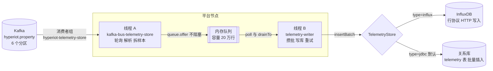

# 遥测数据管道：从 Kafka 到时序库

本文说明设备上报的属性数据（遥测）从 Kafka 的 `hyperiot.property` topic 到 InfluxDB（或关系库）的完整处理过程，对应消费者组 `hyperiot-telemetry-store`。代码位置都标在文中，数据示例来自真实环境。

> 上游（设备到 Kafka）见 [message-lifecycle.md](message-lifecycle.md)；认证、上线下线、其他队列见 [device-lifecycle.md](device-lifecycle.md)。

## 1. 全貌



**一句话**：Kafka 消费线程只负责“读、解析、入队”，写库由另一个线程成批完成，中间用一个有界内存队列隔开，这样慢的数据库不会拖住 Kafka 消费，设备流量尖峰也被攒成少量大批次。

| 环节 | 线程 | 做什么 | 是否会阻塞 |
| --- | --- | --- | --- |
| 轮询 Kafka | `kafka-bus-telemetry-store` | 拉消息、JSON 反序列化、拆成样本、入队 | 不会（`queue.offer` 满了就丢弃） |
| 写库 | `telemetry-writer` | 从队列取、攒批、写库、失败重试 | 会（写库期间），但只阻塞自己 |

## 2. 第 1 站：数据在 Kafka 里长什么样

上游把校验通过的数据封装成 `DeviceMessage`（[DeviceMessage.java](../hyperiot-server/src/main/java/io/hyperiot/bus/DeviceMessage.java)）发到 `hyperiot.property`，**key 是设备 ID**，同一设备的所有消息落在同一个分区，所以进入本管道时单设备有序。一条真实的消息：

```json
key   = 195
value = {"kind":"PROPERTY","deviceId":195,"productKey":"hitkinblpxf1","deviceName":"tmpload-0079",
         "ts":1791965608964,
         "payload":{"params":{"temperature":25.1,"humidity":53,"mode":"auto","fan":false},"id":"49042607865800"}}
```

- `ts`：设备上报的时间戳（毫秒；设备没给或不合理时是平台接收时间）。后面所有样本都用这个时间。
- `payload.params`：**已经通过物模型校验**的属性，非法的在接入层就被拒绝了，不会进入 Kafka。

## 3. 第 2 站：订阅

[TelemetryWriter.java:49](../hyperiot-server/src/main/java/io/hyperiot/data/TelemetryWriter.java) 在启动时向事件总线订阅：

```java
@PostConstruct
void start() {
    bus.subscribe("telemetry-store", Set.of(MessageKind.PROPERTY), this::onProperty);
    flusher.start();      // 同时启动线程 B
}
```

Kafka 实现（[KafkaEventBus.subscribe](../hyperiot-server/src/main/java/io/hyperiot/bus/KafkaEventBus.java)）创建一个消费者和一个轮询线程：

```java
p.put(ConsumerConfig.GROUP_ID_CONFIG, cfg.getGroupPrefix() + group);    // hyperiot-telemetry-store
p.put(ConsumerConfig.AUTO_OFFSET_RESET_CONFIG, "latest");                // 新组只读新消息，不回放历史
p.put(ConsumerConfig.ENABLE_AUTO_COMMIT_CONFIG, "true");                 // 自动提交位移
KafkaConsumer<String, String> consumer = new KafkaConsumer<>(p);
consumer.subscribe(kinds.stream().map(this::topic).toList());           // hyperiot.property
new Poller(group, consumer, handler).start();
```

| 要点 | 说明 |
| --- | --- |
| 消费者组 | `hyperiot-telemetry-store`。多个平台节点用同一个组名，Kafka 把 6 个分区分给各节点，自动分摊 |
| 并行度上限 | 分区数 6，节点超过 6 个就有节点分不到分区 |
| `latest` | 新建的组不回放历史；组一旦有已提交的位移，重启后从上次位置继续 |
| 为什么每个订阅者一个线程 | 各订阅者（shadow、rule-engine 等）互相隔离，一个慢不会拖住别的 |

## 4. 第 3 站：轮询线程（线程 A）

[Poller.run](../hyperiot-server/src/main/java/io/hyperiot/bus/KafkaEventBus.java)：

```java
while (running) {
    for (ConsumerRecord<String, String> r : consumer.poll(Duration.ofMillis(300))) {
        try {
            handler.accept(Json.read(r.value(), DeviceMessage.class));   // 反序列化，交给 onProperty
        } catch (Exception e) {
            log.error("Subscriber '{}' failed on record {}-{}@{}", group, r.topic(), r.partition(), r.offset(), e);
        }
    }
}
```

- 一次 `poll` 可能拿到很多条消息，逐条处理。
- **一条消息处理失败只记日志，不影响后面的消息，也不会重试**。
- 这个线程做的事很轻（解析、拆分、入队），所以一个线程处理本节点分到的所有分区够用。

## 5. 第 4 站：拆成样本并入队

[onProperty](../hyperiot-server/src/main/java/io/hyperiot/data/TelemetryWriter.java)：

```java
private void onProperty(DeviceMessage m) {
    JsonNode params = m.payload().get("params");
    if (params == null) return;
    params.fields().forEachRemaining(e -> {
        TelemetryStore.Row row = toRow(m.deviceId(), e.getKey(), m.ts(), e.getValue());
        if (row != null && !queue.offer(row)) {                       // 非阻塞入队
            if (dropped++ % 1000 == 0) {
                log.warn("Telemetry queue full, {} samples dropped so far", dropped);
            }
        }
    });
}
```

**一条消息变成多条样本**，每个属性一行 `Row(deviceId, identifier, ts, num, str)`。上面那条真实消息拆成 4 行：

| deviceId | identifier | ts | num | str |
| --- | --- | --- | --- | --- |
| 195 | temperature | 1791965608964 | 25.1 | — |
| 195 | humidity | 1791965608964 | 53.0 | — |
| 195 | mode | 1791965608964 | — | `auto` |
| 195 | fan | 1791965608964 | 0.0 | — |

类型转换规则（`toRow`）：

| JSON 值 | 存成 | 说明 |
| --- | --- | --- |
| 布尔 | `num` = 1.0 / 0.0 | 曲线图可以直接画 |
| 数字 | `num` = 浮点数 | 整数也转成浮点 |
| 字符串（含枚举） | `str` | 超过 1024 字符截断 |
| 对象、数组、null | 丢弃 | 返回 `null`，不入队 |

**队列**是 `LinkedBlockingQueue`，容量 `QUEUE_CAPACITY = 200_000`（代码常量，不可配置）。入队用 `offer`（不等待），队列满了直接丢弃新样本并告警（每 1000 条提示一次），**绝不阻塞 Kafka 消费线程**。

## 6. 第 5 站：攒批写库（线程 B）

[loop](../hyperiot-server/src/main/java/io/hyperiot/data/TelemetryWriter.java)：

```java
while (running || !queue.isEmpty()) {
    Row first = queue.poll(cfg.getFlushInterval().toMillis(), TimeUnit.MILLISECONDS);   // 最多等 500ms
    if (first == null) continue;
    batch.add(first);
    queue.drainTo(batch, cfg.getBatchSize() - 1);                                       // 再立刻取，凑到 500 行
    flush(batch);
    batch.clear();
}
```

**什么时候写一批**：队列里有数据就取，最多等 500ms（`flush-interval`），一批最多 500 行（`batch-size`）。流量小时每 500ms 内到达的样本合成一批；流量大时一取就是 500 行满批，立即写。

**失败重试**（`flush`）：

```java
for (int attempt = 1; ; attempt++) {
    try { repo.insertBatch(rows); return; }
    catch (RuntimeException e) {
        if (attempt >= 4 || !running) throw e;                  // 最多 4 次尝试，仍失败就放弃这批
        Thread.sleep(backoff); backoff *= 2;                    // 退避 500ms → 1s → 2s
    }
}
```

重试用于抵挡数据库短暂不可用；超过 4 次仍失败，这一批被丢弃并记 `Failed to write telemetry batch` 日志，继续处理下一批。

### 写入 InfluxDB

[InfluxTelemetryStore.insertBatch](../hyperiot-server/src/main/java/io/hyperiot/data/InfluxTelemetryStore.java) 把每行转成行协议，一次 HTTP 请求写入一整批：`POST /write?db=hyperiot&precision=ms`。上面的 4 行样本变成：

```
telemetry,device_id=195,identifier=temperature num=25.1 1791965608964
telemetry,device_id=195,identifier=humidity num=53.0 1791965608964
telemetry,device_id=195,identifier=mode str="auto" 1791965608964
telemetry,device_id=195,identifier=fan num=0.0 1791965608964
```

- `device_id`、`identifier` 是 **tag**（可索引，用于过滤）；`num`、`str` 是 **field**（值）。
- **数值一律带小数点**（`53.0` 而不是 `53`）：InfluxDB 以第一次写入决定字段类型，写成整数后再写小数会被拒绝（field type conflict）。
- 进入行协议的标识符只可能是通过物模型校验的 `[a-zA-Z][a-zA-Z0-9_]{0,63}`，写入前再校验一次，不会有注入。
- 同一时间戳、同一序列的点会被覆盖，所以重复投递不会产生重复数据。

### 写入关系库（默认 `type=jdbc`）

[JdbcTelemetryStore.insertBatch](../hyperiot-server/src/main/java/io/hyperiot/data/JdbcTelemetryStore.java) 用 `JdbcTemplate.batchUpdate` 批量 `INSERT INTO telemetry(device_id, identifier, ts, num_value, str_value)`，每 500 行一个 JDBC 批。关系库没有覆盖语义，重复投递会产生重复行。

## 7. 停机与过期

- **停机**：`@PreDestroy stop()` 把 `running` 置为 false，写线程会把队列里剩余的样本全部写完再退出（最多等 5 秒）。
- **过期**：每天 03:17 `purge()` 调用 `deleteOlderThan`。关系库删除 `retention-days`（默认 30）天前的数据；InfluxDB 由保留策略自己过期，这里什么都不做。

## 8. 查询是怎么读回来的

控制台的历史曲线调用 `GET /api/devices/{id}/telemetry`（[DeviceDataController](../hyperiot-server/src/main/java/io/hyperiot/device/DeviceDataController.java)），按 `agg` 参数走 `TelemetryStore.raw` 或 `aggregate`。InfluxDB 下聚合用 `GROUP BY time(Nms) fill(none)`，与关系库的整数分桶对齐方式一致。

## 9. 可靠性：数据可能在哪里丢

| 环节 | 保证 | 出问题时 |
| --- | --- | --- |
| Kafka 位移提交 | **自动提交，在消息读出之后就提交，不等写库成功** | 平台在“已入队、未写库”时崩溃，这部分样本丢失，Kafka 不会重发（至多一次） |
| 入队 | 队列满则丢弃 | 日志 `Telemetry queue full`；Kafka 积压仍为 0，**积压为 0 不代表数据都写进去了** |
| 写库 | 最多 4 次尝试 | 日志 `Failed to write telemetry batch`，该批丢弃 |
| 重复 | InfluxDB 同点覆盖，天然去重；关系库可能重复 | — |
| 顺序 | 同一设备同分区、单线程入队、批内保序 | — |

设计取舍：遥测是高频、可容忍极少量丢失的数据，所以优先保证**不拖垮接入层和 Kafka 消费**，而不是追求每一条都落库。指令、OTA、告警这类控制类数据不走这条路，它们存在数据库状态机里，见 [message-lifecycle.md](message-lifecycle.md)。

## 10. 配置

| 配置项 | 默认 | 作用 |
| --- | --- | --- |
| `hyperiot.telemetry.batch-size` | `500` | 每批最多多少行 |
| `hyperiot.telemetry.flush-interval` | `500ms` | 队列里有数据时最多等多久再取，也是流量小时的写入间隔 |
| `hyperiot.telemetry.retention-days` | `30` | 数据保留天数（关系库每天清理；InfluxDB 写入保留策略） |
| `hyperiot.timeseries.type` | `jdbc` | `jdbc` 或 `influx` |
| `hyperiot.bus.type` | `memory` | 用 Kafka 时设为 `kafka`（`prod` profile 自动设置） |

队列容量（20 万）和 Kafka topic 的分区数（6）是代码里的常量，不是配置项。

## 11. 排查

**消费有没有跟上**（在 Kafka 所在机器上）：

```bash
docker exec <kafka容器名> /opt/kafka/bin/kafka-consumer-groups.sh \
  --bootstrap-server localhost:9092 --describe --group hyperiot-telemetry-store
```

看 `LAG` 列：持续增长说明消费线程跟不上（多半是 JSON 解析或 CPU 受限）；为 0 说明消费线程跟上了。

**写库有没有跟上**：Kafka 积压看不出来，要看平台日志：

| 日志 | 含义 |
| --- | --- |
| `Writing N samples failed (attempt k)... Retrying` | 数据库 / InfluxDB 暂时不可用，正在退避重试 |
| `Failed to write telemetry batch of N rows` | 重试用尽，该批已丢弃 |
| `Telemetry queue full, N samples dropped so far` | 写库长时间跟不上，队列已满，正在丢弃新样本 |
| `InfluxDB write failed: HTTP 400 ... field type conflict` | 同一个 `identifier` 的 `num` 字段曾经被写成整数，需要清理该序列 |

**数据对不对**：InfluxDB 里 `SELECT * FROM telemetry WHERE device_id='195' ORDER BY time DESC LIMIT 5`，应能看到和 Kafka 消息对应的点。

## 12. 局限与可改进的地方

- **位移早提交**：要做到“写库成功才算消费”，需要把自动提交改成手动提交，并在批写成功后才提交；代价是实现复杂度和重复写入（InfluxDB 下重复无害）。
- **队列深度没有指标**：目前只能从日志判断队列满，可以加一个 Micrometer 仪表暴露队列大小和丢弃数。
- **单节点单写线程**：写入量大到一个线程写不过来时，需要多个写线程或更多节点。
- **丢弃不可补**：队列满丢弃的样本没有补偿机制。
